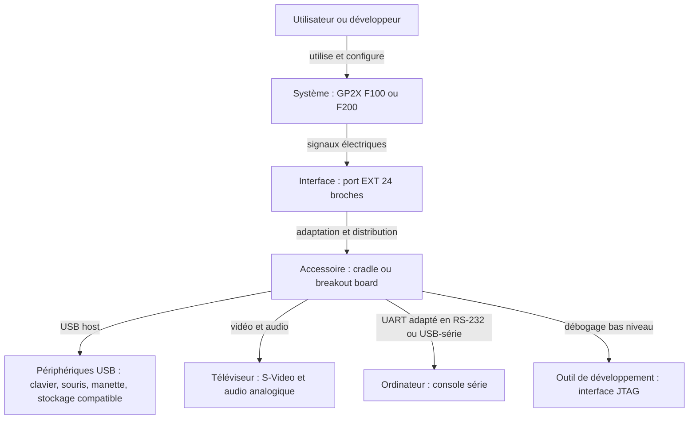
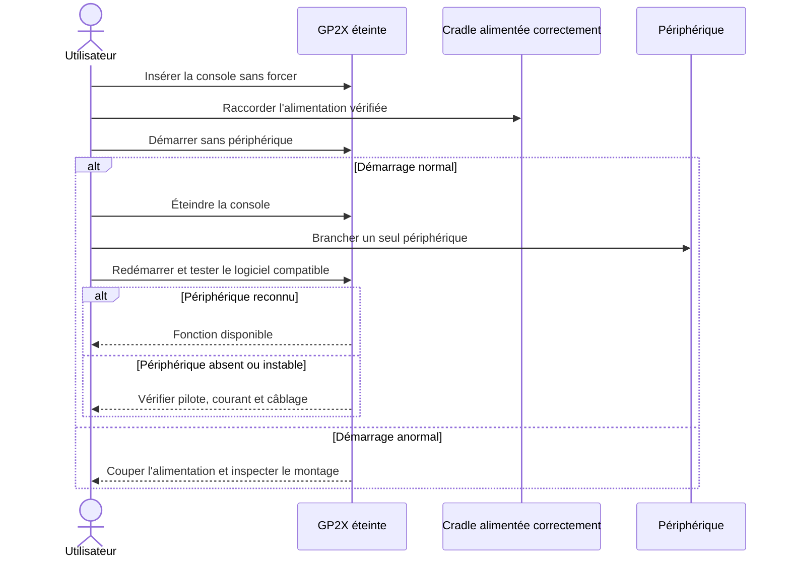
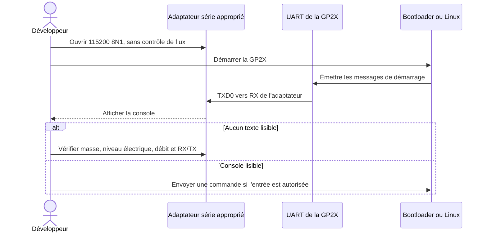

# GP2X Cradle et breakout boards — guide pratique

> **État de la documentation — 24 octobre 2026**
>
> Ce guide concerne les **GP2X F100 et F200** équipées du connecteur inférieur `EXT`. Il ne s’applique pas à la GP32, à la Wiz ni à la Caanoo. Les accessoires ont plusieurs révisions et sont aujourd’hui anciens : vérifier les inscriptions et l’état électrique de l’exemplaire réel avant de l’alimenter.

## Réponse courte

La GP2X expose par son port `EXT` des signaux qui ne disposent pas tous d’une prise standard sur la console : **USB host**, **sortie TV S-Video et audio**, **liaison série UART**, **JTAG**, masse et alimentation logique 3,3 V. Une cradle ou une breakout board relie ces signaux à des connecteurs plus faciles à utiliser et peut ajouter les circuits nécessaires, par exemple un hub USB et une conversion UART vers RS-232.

La **cradle commerciale** est la solution prête à l’emploi : elle accueille la console et fournit notamment quatre ports USB, une sortie S-Video/audio et un port série RS-232. Une **breakout board** de développement expose davantage les signaux de bas niveau, notamment le JTAG. Une carte DIY peut ne fournir qu’une partie de ces fonctions.

Le boîtier ne crée pas de pilotes. La GP2X doit disposer du pilote Linux adapté au périphérique USB ou du logiciel capable d’activer la sortie TV.

## Cradle, breakout board ou simple câble ?

| Solution | Usage principal | Interfaces typiques | Difficulté | Point d’attention |
|---|---|---|---|---|
| Cradle commerciale GPH | Transformer la GP2X en petit poste fixe | 4 × USB host, S-Video, audio, RS-232 ; JTAG présent sur certaines cartes internes d’après les exemplaires documentés | Faible à moyenne | La cradle et son hub doivent recevoir une alimentation correcte. |
| Breakout board officielle de développement | Développement, console série et récupération | USB, série, JTAG, vidéo/audio selon la révision | Moyenne à élevée | Certaines interfaces sont destinées à du matériel de laboratoire ancien, dont le port parallèle pour le JTAG « wiggler ». |
| Breakout board tierce ou DIY | Exposer uniquement les signaux nécessaires | Variable : USB host, UART TTL, JTAG, TV-out | Élevée | Le nom « breakout board » ne garantit ni conversion de niveau, ni protection, ni alimentation USB 5 V. |
| Câble TV-out officiel | Afficher l’image et sortir le son | S-Video/composite selon le câble, audio | Faible | Ce câble n’ajoute pas de ports USB, série ou JTAG. |

## Ce que l’on peut faire

### Utilisation de bureau ou de salon

- brancher un clavier et une souris USB pour les environnements PDA ou les logiciels qui les reconnaissent ;
- utiliser une ou plusieurs manettes USB avec les jeux et émulateurs compatibles ;
- afficher les applications et vidéos sur un téléviseur via S-Video ;
- sortir le son stéréo vers un téléviseur, un amplificateur ou des enceintes actives ;
- connecter du stockage USB si le noyau, le firmware, le système de fichiers et l’application le prennent en charge.

La présence physique d’un port USB ne suffit pas à garantir qu’un appareil fonctionnera. Les périphériques exigeant beaucoup de courant, des pilotes modernes ou l’USB 2.0 haut débit sont de mauvais candidats. Le contrôleur host de la GP2X est documenté comme **USB 1.1**.

### Développement et diagnostic

- lire les messages de démarrage et obtenir une console Linux par la liaison série ;
- transférer des commandes ou automatiser des tests par UART ;
- utiliser le JTAG pour l’inspection bas niveau, le débogage ou certaines opérations de récupération ;
- observer ou exploiter les signaux du port EXT dans un montage expérimental.

Le JTAG n’est pas une procédure de « débrick » automatique. Sa fiabilité varie selon les révisions, et le signal `nRESET` du connecteur a changé sur certaines F100 MK2. Une erreur de câblage ou une commande d’écriture incorrecte peut aggraver une panne.

## Mise en service sûre d’une cradle existante

### 1. Identifier le matériel

Avant tout branchement :

1. confirmer que la console est une GP2X F100 ou F200 ;
2. photographier les étiquettes de la cradle, de son alimentation et de la console ;
3. vérifier que le connecteur EXT n’a ni broche tordue, ni corrosion, ni corps étranger ;
4. vérifier que l’alimentation est **régulée** et correspond exactement à la tension, la polarité et l’intensité inscrites sur la cradle ;
5. ne pas supposer que l’adaptateur secteur de la GP2X convient à la cradle : leurs besoins et connecteurs peuvent être différents.

> **Important :** le port EXT fournit du **3,3 V** sur ses broches d’alimentation, y compris sur la F200 d’après les mesures historiques. Ce n’est pas une source USB 5 V. Ne jamais relier directement ces broches au `VBUS` 5 V d’une prise USB.

### 2. Faire un premier essai minimal

1. éteindre la GP2X et la cradle ;
2. ne brancher encore aucun périphérique USB, câble série ou téléviseur ;
3. insérer la GP2X dans la cradle sans forcer ni incliner le connecteur ;
4. raccorder l’alimentation conforme de la cradle ;
5. démarrer la GP2X et vérifier qu’elle fonctionne normalement ;
6. éteindre de nouveau avant d’ajouter un câble ou un périphérique.

Cette approche isole les problèmes de contact et d’alimentation avant d’ajouter d’autres variables.

### 3. Ajouter une fonction à la fois

## Utiliser les ports USB host

1. commencer avec un clavier, une souris ou une manette USB simple et peu énergivore ;
2. connecter un seul appareil ;
3. démarrer la console puis lancer une application connue pour gérer ce type de périphérique ;
4. si un shell est disponible, examiner les messages du noyau avec `dmesg` et la liste des périphériques sous `/proc/bus/usb` lorsque ce système de fichiers existe sur le firmware utilisé ;
5. ajouter les autres appareils un par un.

Un périphérique peut échouer pour quatre raisons distinctes : alimentation 5 V insuffisante, câble ou hub défectueux, absence de pilote dans le noyau, ou absence de prise en charge dans l’application. Une clé USB moderne peut aussi consommer trop au démarrage ou utiliser un format de fichiers non pris en charge.

## Utiliser la sortie TV et audio

1. console et téléviseur éteints, connecter S-Video et les sorties audio ;
2. sélectionner l’entrée correspondante sur le téléviseur ;
3. démarrer la GP2X ;
4. activer la sortie TV dans le logiciel ou l’utilitaire prévu par le firmware ;
5. choisir le standard vidéo approprié, généralement PAL ou NTSC selon le téléviseur et le logiciel.

La sortie TV n’est pas nécessairement active dès l’allumage et toutes les applications ne la gèrent pas nativement. Un écran noir peut donc être un problème logiciel ou de standard vidéo, pas forcément une panne de la cradle.

## Utiliser la console série

La GP2X fournit un **UART logique 3,3 V** sur le port EXT. La prise DB9 d’une cradle officielle est décrite comme une interface **RS-232**, donc adaptée par des circuits internes. Ces deux niveaux électriques ne sont pas interchangeables.

- Avec la DB9 de la cradle, utiliser un port série RS-232 réel ou un adaptateur USB-vers-RS-232.
- Avec une breakout board qui expose directement `TXD0` et `RXD0`, utiliser un adaptateur USB-UART compatible **3,3 V**, sans injecter de 5 V.
- Croiser les données : `TX` de la GP2X va vers `RX` de l’adaptateur, `RX` vers `TX`, avec une masse commune.
- Un développeur ayant construit une carte moderne rapporte une console fonctionnelle à **115200 bauds, 8 bits, sans parité, 1 bit d’arrêt (`115200 8N1`)**. Cette valeur constitue un bon point de départ, mais doit être confirmée avec le bootloader ou le firmware utilisé.

## Utiliser le JTAG

Le JTAG s’adresse aux personnes qui savent identifier la cible ARM, configurer leur interface et éviter toute écriture destructive. Les cartes GPH documentées intègrent un adaptateur de type « wiggler » prévu pour un port parallèle. Des interfaces USB modernes peuvent être raccordées au JTAG brut avec une carte adaptée et une configuration OpenOCD correcte.

Limites connues :

- la connexion est rapportée comme peu fiable sur certaines F100, particulièrement des MK2 ;
- le signal de réinitialisation du port EXT ne se comporte pas de la même manière sur toutes les révisions ;
- une configuration OpenOCD conçue pour une interface donnée doit être adaptée à l’interface réellement utilisée ;
- le JTAG expose des fonctions capables de modifier l’état du système : commencer par des lectures non destructives.

## Diagnostic rapide

| Symptôme | Vérifications prioritaires |
|---|---|
| La GP2X ne démarre plus une fois insérée | Couper immédiatement ; contrôler orientation, connecteur, court-circuit, alimentation et polarité. Tester la console seule. |
| Aucun périphérique USB n’apparaît | Vérifier l’alimentation 5 V du hub/cradle, tester un appareil peu énergivore, consulter les messages du noyau et confirmer le pilote. |
| Un clavier marche mais pas une clé USB | Vérifier la consommation, le pilote de stockage, les partitions et le système de fichiers. |
| Image absente sur le téléviseur | Confirmer l’entrée S-Video, PAL/NTSC et l’activation logicielle de TV-out. |
| Texte série illisible | Confirmer `115200 8N1`, masse commune, croisement TX/RX et surtout le choix RS-232 contre UART 3,3 V. |
| Aucun texte série | Tester le bon port, RX/TX, la masse, l’adaptateur et le moment du démarrage ; vérifier que la board réalise bien une conversion de niveau. |
| JTAG instable | Identifier précisément la révision, raccourcir les liaisons, abaisser la fréquence et vérifier la gestion de `nRESET`. |

## Ce qu’il ne faut pas faire

- alimenter le bus USB à partir des broches 3,3 V du port EXT ;
- connecter directement un port RS-232 de PC aux broches UART 3,3 V ;
- injecter 5 V dans `RXD0`, `TXD0` ou les broches 3,3 V ;
- insérer ou retirer un connecteur bricolé sous tension ;
- se fier uniquement à la couleur des fils d’un câble de téléphone recyclé ;
- copier le brochage d’une prise mâle vers une prise femelle sans tenir compte de l’effet miroir ;
- lancer une écriture JTAG ou une restauration NAND sans image, procédure et révision matérielle confirmées.

## Sources et niveau de preuve

Sources consultées le 24 octobre 2026 :

- [GP2X Wiki archivé — EXT Port](https://archive.ph/Ts6AB) : fonctions du port, brochage historique, niveaux 3,3 V et avertissement sur `nRESET` ;
- [manuel utilisateur GP2X, « Breakout Board Guide », copie ManualsLib](https://www.manualslib.com/manual/623082/Gamepark-Holdings-Gp2x.html?page=41) : l’index et l’extrait public confirment l’accessoire officiel, l’USB et le port série de débogage ; la page complète est protégée par un contrôle d’accès automatisé ;
- [Engadget — lancement de la cradle commerciale, 23 avril 2007](https://www.engadget.com/2007-04-23-gp2x-commercial-interface-board-cradle-goes-on-sale.html) : quatre ports USB, RS-232, S-Video et audio ;
- [GP2X Dev — carte de développement moderne](https://gp2x.dev/devboard/) : présence du JTAG sur les cartes GPH observées, UART à 115200 8N1, ressources OpenOCD et retour d’expérience sur la fiabilité JTAG ;
- [Wikipedia — GP2X, section Expandability](https://en.wikipedia.org/wiki/GP2X#Expandability) : synthèse secondaire sur le port EXT, l’USB host et les connecteurs compatibles.

Aucune cradle ni breakout board n’a été testée physiquement pendant la rédaction. Les connecteurs exacts, la tension d’entrée de la cradle, le brochage des prises externes et la présence de fonctions internes peuvent varier selon la révision. Toujours privilégier les inscriptions du matériel et des mesures hors tension avant un câblage expérimental.

## Voir aussi

- [Port EXT de la GP2X — référence technique](gp2x-port-ext-reference.md)
- [GP2X F200 — diagnostic matériel et alimentation](GP2X_F200_hardware_diagnostic.md)
- [Répertoire de sites web consacrés à la GP2X](sites-web-gp2x.md)
