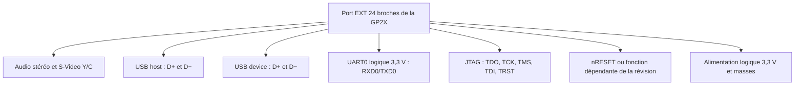
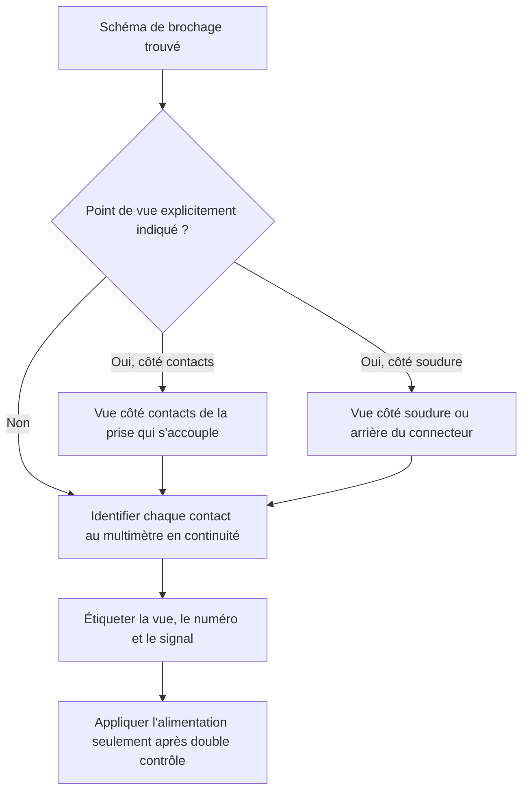
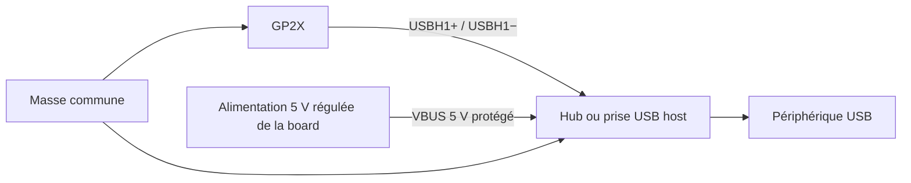
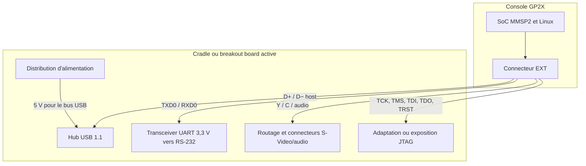

# Port EXT de la GP2X — référence technique

> **Référence historique, non validée sur chaque révision — 24 octobre 2026**
>
> Cette page complète le [guide pratique de la cradle et des breakout boards](gp2x-cradle-et-breakout-board.md). Elle s’adresse à la fabrication, au contrôle et au diagnostic d’interfaces. Ne câbler aucun accessoire uniquement à partir du numéro d’une broche : confirmer l’orientation du connecteur et les niveaux au multimètre.

## Fonctions exposées

Le connecteur `EXT` inférieur comporte 24 contacts et regroupe plusieurs interfaces indépendantes :

Une cradle n’utilise pas nécessairement chaque signal et peut transformer les interfaces : un hub distribue par exemple l’unique lien USB host vers quatre prises, tandis qu’un transceiver convertit l’UART logique en niveaux RS-232.

## Brochage historique

Le tableau suivant retranscrit le brochage publié par le GP2X Wiki. La vue annoncée par cette source est **depuis l’avant de la console, en regardant dans la prise EXT de la GP2X**. L’autre extrémité d’un câble est généralement en miroir.

| Broche | Signal | Groupe | Remarque |
|---:|---|---|---|
| 1 | `AUDIO_GND` | Audio | Masse audio |
| 2 | `TV_SND_R` | Audio | Canal droit |
| 3 | `TV_SND_L` | Audio | Canal gauche |
| 4 | `SV_OUT_C` | Vidéo | Chrominance S-Video |
| 5 | `SV_OUT_Y` | Vidéo | Luminance S-Video |
| 6 | `AUDIO_GND` | Audio | Masse audio |
| 7 | `GND_TV` | Vidéo | Masse vidéo |
| 8 | `GND_TV` | Vidéo | Masse vidéo |
| 9 | `USBH1-` | USB host | Paire différentielle D− |
| 10 | `USBH1+` | USB host | Paire différentielle D+ |
| 11 | `USBD-` | USB device | Paire différentielle D− |
| 12 | `USBD+` | USB device | Paire différentielle D+ |
| 13 | `GND` | Commun | Masse numérique |
| 14 | `JTAG_TDO` | JTAG | Test Data Out |
| 15 | `JTAG_TCK` | JTAG | Test Clock |
| 16 | `JTAG_TMS` | JTAG | Test Mode Select |
| 17 | `JTAG_TDI` | JTAG | Test Data In |
| 18 | `JTAG_TRST` | JTAG | Test Reset ; noté `TRS` dans la table historique |
| 19 | `nRESET` | Système | Fonction modifiée ou non utilisable comme reset sur certaines F100 MK2 |
| 20 | `+3.3V` | Alimentation | **Pas du 5 V USB** |
| 21 | `+3.3V` | Alimentation | **Pas du 5 V USB** |
| 22 | `RXD0 / GPD0` | UART | Entrée série de la GP2X, logique 3,3 V |
| 23 | `TXD0 / GPD1` | UART | Sortie série de la GP2X, logique 3,3 V |
| 24 | `GND` | Commun | Masse numérique |

## Orientation : le principal risque de fabrication

Les schémas historiques représentent tour à tour la prise de la console, le connecteur du câble vu côté contacts, ou le côté soudure. Une copie directe peut donc inverser les broches.

Une photographie annotée de **votre** connecteur, prise avant démontage, est plus sûre qu’un code couleur de câble. Les câbles de téléphones Samsung ou LG compatibles mécaniquement n’ont pas tous le même câblage interne et certaines variantes de détrompeur ne s’insèrent pas.

## Domaines électriques à ne pas confondre

### Alimentation du port EXT

Les broches 20 et 21 sont documentées à **3,3 V**, y compris sur la F200. D’anciennes discussions évoquaient 5 V sur certaines F100 MK2, mais la source historique elle-même les présente comme non confirmées. La conception sûre consiste donc à traiter ces contacts comme du 3,3 V de faible puissance, jamais comme une alimentation de périphériques USB.

### Alimentation USB host

Une prise USB-A hôte doit normalement fournir un `VBUS` de 5 V en plus de D+, D− et GND. Le port EXT donne la paire de données USB host, mais pas un rail 5 V USB fiable. Une cradle ou une breakout board doit donc produire ou recevoir séparément ce 5 V, avec une masse commune et une protection adaptées.

Ce diagramme décrit le principe, pas un schéma de construction complet. Une réalisation réelle doit également gérer le découplage, la limitation/protection de courant et l’intégrité de la paire différentielle.

### UART TTL 3,3 V contre RS-232

| Interface | Tension typique | Connecteur possible | Connexion sûre |
|---|---|---|---|
| UART du port EXT | Logique 0–3,3 V | Broches nues d’une breakout board | Adaptateur USB-UART 3,3 V |
| RS-232 de la cradle | Tensions positives et négatives RS-232 | Souvent DB9 | Port RS-232 ou adaptateur USB-RS-232 |

Un câble passif ne convertit pas ces niveaux. Un transceiver RS-232, par exemple de famille MAX3232 correctement alimenté et câblé, est nécessaire entre les deux domaines lorsqu’il n’est pas déjà présent sur la board.

## Rôle d’une cradle complète

Les sorties réellement présentes dépendent de la carte. Une board passive peut seulement exposer des broches, sans hub, sans conversion de niveau et sans alimentation régulée.

## Contrôle d’une board inconnue

### Hors tension

1. relever toutes les références de circuits intégrés et les inscriptions des connecteurs ;
2. vérifier visuellement les condensateurs, soudures, pistes et connecteurs ;
3. chercher les courts-circuits francs entre chaque rail d’alimentation et la masse ;
4. cartographier en continuité les masses et les signaux jusqu’au connecteur EXT ;
5. déterminer si le port série traverse un transceiver ou rejoint directement `RXD0/TXD0` ;
6. déterminer d’où vient le 5 V des ports USB.

### Sous tension, sans GP2X

Cette étape n’est appropriée que si la tension, la polarité et le connecteur d’alimentation de la board sont certains.

1. employer une alimentation de laboratoire limitée en courant lorsque c’est possible ;
2. mesurer les rails sans périphérique ;
3. vérifier le 5 V USB sur `VBUS` et l’absence de 5 V sur les lignes de données ou le domaine 3,3 V ;
4. couper au premier échauffement, bruit, odeur ou courant anormal.

### Avec la GP2X

Connecter d’abord la console seule, puis une seule fonction à la fois, selon la procédure du [guide pratique](gp2x-cradle-et-breakout-board.md#mise-en-service-sûre-dune-cradle-existante).

## Connecteurs de récupération

Les sources historiques citent des connecteurs provenant de câbles de téléphones Samsung E810/E730 et de certains LG U8110/U8120/U8130/U8136/U8138. Une référence de connecteur `A11-577-2401`, décrite comme `B340/SPH-V8250/B4100`, apparaît aussi dans le GP2X Wiki.

Ces informations aident à retrouver une **coque compatible**, mais ne garantissent ni le détrompage, ni la présence des 24 contacts, ni le câblage. Démonter le câble et identifier chaque contact avant toute utilisation.

## Points encore à documenter sur matériel réel

- photographies recto/verso et références des différentes révisions GPH ;
- tension, polarité et consommation exactes de chaque cradle ;
- brochage des DB9 et connecteurs JTAG externes selon la révision ;
- type et référence du hub USB et du transceiver série ;
- comportement du signal de reset sur chaque F100 First Edition, normale, MK2 et F200 ;
- courant USB disponible et protections présentes ;
- compatibilité observée avec les firmwares officiels et Open2X.

## Sources

- [GP2X Wiki archivé — EXT Port](https://archive.ph/Ts6AB), dernière modification historique indiquée au 7 juillet 2008 ;
- [GP2X Dev — GP2X dev board](https://gp2x.dev/devboard/), schéma et retour d’expérience d’une interface moderne ;
- [Engadget — GP2X Commercial Interface Board Cradle](https://www.engadget.com/2007-04-23-gp2x-commercial-interface-board-cradle-goes-on-sale.html), description commerciale contemporaine ;
- [Wikipedia — GP2X](https://en.wikipedia.org/wiki/GP2X#Expandability), source secondaire pour le contexte et les familles de connecteurs.

Le brochage n’a pas été contrôlé sur une console réelle pendant cette rédaction. Toute fabrication doit être précédée d’une vérification d’orientation, de continuité et de tension.
