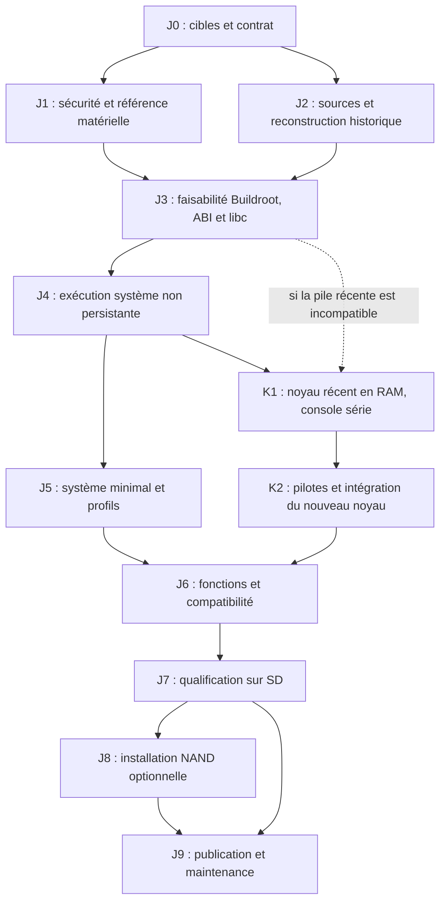

# Moderniser Open2X sur GP2X F100 et F200 — plan incrémental

> **Proposition de plan — 30 octobre 2026.** Aucun jalon matériel n’est validé. Ce document planifie les travaux ; il ne constitue pas une procédure de flashage. Buildroot est le candidat privilégié, pas une compatibilité acquise.

## 1. Objectif et premier résultat utile

Construire un successeur maintenable d’Open2X pour GP2X F100 et F200 : sources identifiées, construction reproductible, mises à jour contrôlées et compatibilité mesurée avec les logiciels historiques.

**Premier résultat utile : reconstruire et exécuter un programme de diagnostic sur le système existant depuis la SD, sans modifier la NAND.** Le premier objectif n’est ni un flashage complet ni un noyau récent.

Le développement doit laisser une version utilisable à chaque étape. Une version expérimentale fonctionnant depuis la SD, ou seulement un ensemble d’applications reconstruites, constitue un livrable valable si les étapes suivantes sont bloquées.

### Périmètre et hypothèses

- **Cibles :** F100 et F200 ; F100 First Edition/MK2 et F200(B) sont des profils distincts à qualifier. Aucun résultat obtenu sur une révision ne vaut automatiquement pour les autres.
- **Base :** artefacts Open2X, sources et bibliothèques historiques, avec une correspondance source/binaire à établir.
- **Construction candidate :** Buildroot, version et libc sélectionnées seulement après étude de compatibilité.
- **Priorités :** récupération, intégrité des données, reproductibilité, fonctions essentielles, compatibilité applicative, puis enrichissements.
- **Hors périmètre initial :** Wiz/Caanoo, overclocking, remplacement du bootloader, reformatage NAND, ajout de fonctionnalités réseau publiques, accélération ou coprocesseur réécrit.
- **Matériel requis pour conclure :** au moins une F100 et une F200 saines, accès UART vérifié, cartes SD de test et moyen de récupération adapté à chaque unité. La F200(B) reste non prise en charge tant qu’un exemplaire et une référence logicielle compatible ne sont pas disponibles.
- **À décider en J0 :** compatibilité binaire indispensable ou recompilation acceptable, applications prioritaires, révisions possédées, récupération disponible et objectif final SD seulement ou installation NAND.

Le plan reste public dans `docs/` comme le reste de ce projet documentaire. Il ne crée pas de deuxième feuille de route privée. Un futur dépôt d’implémentation devra référencer cette proposition ou en annoncer explicitement le remplacement.

## 2. Faits disponibles et inconnues bloquantes

Le [relevé des sources Open2X](sources-techniques-migration-f100.md) donne les éléments suivants, qui n’ont pas été revalidés par une compilation pendant cette rédaction :

| Élément | Ce que l’on sait | Conséquence pour le plan |
|---|---|---|
| Sources historiques | Arbres Linux 2.4.25/2.4.26, bootloaders, toolchains, `buildroot` et `buildroot-new` archivés | Ne pas assimiler le dernier SVN à la source exacte d’Open2X DR7. Épingler des révisions, pas `HEAD`. |
| Configuration F100 examinée | `devfs`, rootfs NAND, initrd et NFS root non activés | Ni démarrage direct sur SD ni chargement en RAM ne sont acquis. Le chemin non persistant est un jalon à démontrer. |
| Bootloader historique | Une variante Open2X est explicitement décrite comme très instable | Conserver le bootloader installé ; aucune mise à jour exploratoire. |
| Buildroot historique | Recettes présentes mais état d’achèvement incertain | Référence d’archéologie, pas preuve d’une reconstruction complète. |
| Matériel | ARM920T et ARM940T, 64 Mio de SDRAM et 64 Mio de NAND physiques | Le second cœur n’est pas du SMP Linux ; la RAM libre réelle est inférieure à la capacité physique. |
| F200 | Tactile, commandes et USB à distinguer de la F100 | Profils, calibration et essais indépendants ; ne pas réutiliser aveuglément les pilotes F100. |

**Verrou logiciel :** une libc peut exiger des appels système, des threads ou des mécanismes absents de Linux 2.4. Le choix ARM920T, un compilateur qui produit un ELF, voire un « hello world » réussi, ne suffisent pas à valider le rootfs.

Les contraintes de versions d’en-têtes et de noyau minimal doivent être contrôlées pour la libc et la toolchain exactes. Employer des en-têtes compatibles est nécessaire, mais ne prouve pas à lui seul la compatibilité. `devtmpfs`, apparu bien après Linux 2.4, ne remplace pas `devfs` sans travail d’intégration.

## 3. Stratégie technique : trois voies, pas une migration monolithique

| Voie | Objectif | Limites | Décision |
|---|---|---|---|
| **A — Référence historique** | Reconstituer Open2X et son SDK dans un environnement hôte isolé | Vieilles dépendances et vulnérabilités ; pas une distribution sécurisée moderne | Obligatoire pour comprendre, comparer et revenir en arrière. |
| **B — Modernisation transitoire** | Conserver le noyau historique ; reconstruire sélectivement des outils et éventuellement un rootfs compatible | Buildroot actuel, ses paquets ou son import de toolchain externe peuvent être incompatibles avec l’ABI/libc historiques | Voie privilégiée pour livrer tôt, uniquement si J3 la valide. Un Buildroot ancien épinglé est une dette explicite. |
| **C — Nouveau noyau** | Porter la plateforme sur un noyau encore maintenu, avec une pile utilisateur Buildroot adaptée | Portage de carte et de pilotes, ABI applicative potentiellement rompue, coût majeur | Chantier distinct, nécessaire si l’objectif exige une pile récente impossible sur Linux 2.4. Faisabilité à démontrer. |

Buildroot fabrique des images ; ce n’est pas, à lui seul, un gestionnaire de mises à jour de la console. La politique d’installation, de restauration et de conservation des données doit être conçue séparément.

Ne pas forcer l’import d’un vieux SDK dans Buildroot en désactivant ses vérifications. Si le couple ne peut pas fonctionner, conserver la voie A, limiter B à des paquets construits séparément, ou ouvrir C. **Le support ARM dans Buildroot ne signifie pas qu’une carte GP2X prête à démarrer existe.**

### Dépendances des jalons

K1/K2 ne sont pas requis pour une version explicitement historique/transitoire. Ils deviennent obligatoires si le contrat approuvé exige un noyau maintenu. Aucune flèche ne dispense des garde-fous de J1 ou du chargement non persistant de J4.

## 4. Règles communes à chaque incrément

1. Une modification comportementale principale par lot : outil, bibliothèque, pilote ou profil. Ne pas changer simultanément compilateur, libc, noyau et format d’image.
2. Définir le test et le résultat attendu avant de coder ; relever le comportement Open2X témoin.
3. Compiler et inspecter sur hôte ; tester ensuite sur cible par la voie la moins persistante disponible.
4. Conserver l’artefact précédent, le manifeste et les logs. Un échec doit pouvoir être attribué à un lot et reproduit.
5. Aucune mise à jour NAND avant J8. Aucun changement persistant du bootloader ou de son environnement pour accélérer les essais.
6. Une fonctionnalité non testée est « non qualifiée », pas « probablement supportée ».
7. Réduire le périmètre ou revenir à la dernière référence si un critère de sécurité échoue ; ne pas élargir les tests pour masquer la régression.

**Dossier de preuve par essai :** ID du test, date, modèle/révision et unité anonymisée, firmware et bootloader observés, révisions sources, configuration, toolchain/libc/ABI, empreintes SHA-256 des artefacts, alimentation, carte SD, procédure, attentes, résultat, log série et anomalies. Les empreintes garantissent une identité, pas l’authenticité d’une archive historique.

**Statuts :** non commencé, en cours, bloqué, validé. « Validé » exige le critère de sortie et ses preuves, pas un nombre de cases cochées. Tous les jalons ci-dessous sont initialement **non commencés**.

## 5. Jalons et sous-tâches

### J0 — Fixer le contrat de la première version

**Dépendance :** aucune. **Livrable :** périmètre approuvé et matrice des cibles.

- [ ] Inventorier les consoles disponibles : F100 First Edition/autres/MK2, F200, F200(B), état matériel, firmware et accessoires.
- [ ] Choisir une F100 et une F200 témoins sans panne intermittente ; garder leurs profils séparés.
- [ ] Définir trois niveaux : démarrage minimal, usage quotidien, fonctionnalités optionnelles.
- [ ] Choisir un petit corpus légal de logiciels : application SDL, émulateur avec contenu libre, lecteur audio, utilitaire et programme utilisant l’ARM940T si cette fonction est requise.
- [ ] Décider si les exécutables historiques doivent fonctionner sans recompilation ; noter ceux dont les sources sont absentes.
- [ ] Fixer les budgets mesurables à partir de la référence de J1 : RAM, taille d’image, démarrage, performances, consommation et durée d’essai.
- [ ] Valider le périmètre de sortie : expérimentation SD, firmware transitoire ou remplacement complet maintenu.

**Validation / sortie :** chaque fonction indispensable possède un test, chaque cible possède un état explicite, les inconnues et exclusions sont acceptées. Sans F200(B), celle-ci reste exclue de toute promesse.

### J1 — Établir la sécurité, les sauvegardes et la référence matérielle

**Dépendance :** J0. **Livrables :** fiches unités, baseline et dossier de récupération.

- [ ] Tester la stabilité de chaque console seule : alimentation, SD, écran, audio, commandes et tactile F200. Une console en cours de réparation n’est pas un témoin logiciel fiable.
- [ ] Valider l’UART 3,3 V ou le chemin RS-232 approprié, capturer un démarrage complet ; ne pas déduire le câblage d’une DB9 de sa forme.
- [ ] Identifier en lecture seule bootloader, noyau, partitions, géométrie NAND et systèmes de fichiers. Ne pas recopier un offset trouvé sur Internet.
- [ ] Sauvegarder données utilisateur, paramètres, calibration et contenu système avec une méthode adaptée au noyau de référence.
- [ ] Distinguer sauvegarde logique, dump brut, OOB et ECC ; documenter traitement des blocs défectueux et options des outils. Un dump brut n’est pas automatiquement réinscriptible.
- [ ] Vérifier les sauvegardes par relecture indépendante et comparaison adaptée : données logiques d’un côté, métadonnées NAND de l’autre ; conserver deux copies hors console.
- [ ] Identifier une récupération applicable à chaque révision et son outillage réellement disponible. Vérifier le transport/accès sans écrire ; le JTAG fonctionnant sur une F200 ne prouve rien pour une F100 MK2.
- [ ] Mesurer démarrage, mémoire disponible, charge, performances et fonctions du corpus sur le firmware témoin.

**Validation / sortie :** référence stable, logs série lisibles, sauvegardes vérifiées et limites de récupération explicites pour chaque unité utilisée. Cela autorise les essais non persistants, **pas le flashage**. Une restauration intégrale n’est pas considérée testée à ce stade.

### J2 — Reconstituer les sources et une construction historique

**Dépendance :** J0 ; essai matériel après J1. **Livrables :** manifeste des sources, environnement de build isolé et SDK témoin.

- [ ] Collecter les distributions Open2X F100 et F200, leurs notices et les sources ; identifier séparément la compatibilité F200(B).
- [ ] Exporter une révision SVN exacte et archiver les dépendances avec empreintes, provenance et licences.
- [ ] Comparer scripts de génération d’image, configurations, patches et contenu des images distribuées. Classer chaque composant « correspondance établie », « plausible » ou « inconnue ».
- [ ] Relever GCC/binutils/libc, chargeur ELF, sysroot, ABI ARM OABI/EABI, endianness et soft-float effectifs. Ne pas supposer l’ABI à partir du nom du compilateur.
- [ ] Construire dans un conteneur ou une VM épinglés, sans accès matériel, secrets ni montages hôte superflus ; utiliser une VM ancienne si le conteneur sur noyau hôte récent ne suffit pas.
- [ ] Restaurer d’abord la compilation d’un programme, puis d’une bibliothèque, du noyau de référence et du rootfs, sans déploiement NAND.
- [ ] Corriger séparément les défauts de build hôte et les comportements cible ; conserver les patches ordonnés et motivés.
- [ ] Refaire une construction propre, relever les différences dues aux horodatages ou chemins ; ne pas appeler « bit-identique » une simple compilation répétée.

**Validation / sortie :** chaîne historique reproductible, programme témoin exécutable depuis SD sur les deux modèles qualifiés, et procédure documentée de construction du système de référence. Si la reconstruction complète ne peut être établie, l’usage d’une image binaire témoin est un **repli explicitement approuvé** : il ne ferme pas J2 comme reconstruction complète réussie.

### J3 — Décider si et comment Buildroot convient

**Dépendances :** J1 et J2. **Livrable :** décision d’architecture avec résultats de sondes.

- [ ] Comparer une version maintenue de Buildroot et, seulement si nécessaire, une version intermédiaire/historique ; épingler le candidat exact.
- [ ] Pour chaque combinaison, vérifier ARM920T/ARMv4T, absence de VFP et NEON, ABI, instructions émises, interworking et exigences du noyau minimal.
- [ ] Étudier toolchain interne contre externe, libc et en-têtes ; vérifier que Buildroot accepte réellement le SDK, pas seulement son préfixe.
- [ ] Vérifier modèle de threads et synchronisation, appels système requis, TLS logiciel et exceptions C++ si nécessaires au corpus. Ici TLS désigne aussi le stockage local aux threads ; le distinguer du protocole réseau.
- [ ] Exécuter depuis SD des sondes statiques puis dynamiques : sortie standard, fichiers, allocation, `mmap`, processus, signaux, horloges et threads si utilisés.
- [ ] Inspecter les ELF, leur interpréteur et les bibliothèques requises. Une liaison statique ne supprime pas les exigences de syscall du noyau.
- [ ] Comparer options `/dev` statique/devfs, init minimal et BusyBox compatible ; exclure l’hypothèse implicite systemd/udev/devtmpfs sur Linux 2.4.
- [ ] Tester l’amorçage du SDK applicatif avec SDL et les interfaces Open2X, sans remplacer les bibliothèques système de la console.
- [ ] Définir une durée maximale d’investigation avant revue : ne pas passer indéfiniment à contourner une incompatibilité fondamentale.

**Validation / sortie :** matrice de compatibilité étayée et choix explicite A/B/C. Pour poursuivre B, toutes les sondes nécessaires passent sur F100 et F200 avec les dépendances exactes du rootfs prévu. En cas d’échec, conserver A et ouvrir C ou réduire le livrable ; ne pas déclarer « Buildroot supporté ».

### J4 — Démontrer un chemin d’essai sans écriture NAND

**Dépendances :** J1–J3. **Livrable :** procédure non persistante qualifiée, par modèle.

- [ ] Commencer par l’exécution de binaires et bibliothèques privées depuis SD, avec sorties exclusivement sur SD.
- [ ] Étudier un rootfs de test sous `chroot`, si le noyau et les outils disponibles le permettent. Documenter qu’il partage le noyau et n’isole pas le matériel ni les écritures privilégiées.
- [ ] Inspecter les capacités réelles du bootloader installé : chargement en RAM, support SD, console, transfert et paramètres volatils. Ne pas présumer `kexec`, NFS root, initrd ou boot SD disponibles.
- [ ] Établir la carte mémoire : régions Linux, framebuffer, buffers DMA, code/données ARM940T et zones réservées. Valider taille et emplacement des images avant tout saut d’exécution.
- [ ] Si possible, charger un noyau/rootfs d’essai en RAM ou sur SD sans sauver l’environnement du bootloader ; sinon documenter le blocage et s’arrêter aux sondes applicatives.
- [ ] Interdire l’automontage NAND en écriture et retirer les outils d’écriture du profil expérimental ; garder l’accès lecture seul si nécessaire à la mesure.
- [ ] Auditer les scripts d’amorçage et de test pour éviter toute modification du firmware, des paramètres ou de la calibration internes.
- [ ] Vérifier que retrait de la SD et redémarrage retrouvent la référence sans réparation ; comparer les données persistantes pertinentes avant/après, en tenant compte des écritures normales du système témoin.

**Validation / sortie :** démarrage expérimental reproductible et retour à la référence démontré sur chaque cible, sans écriture NAND introduite par le prototype. Si seul un `chroot` fonctionne, le résultat est un jalon partiel : il ne valide pas l’amorçage et n’autorise ni K1 ni J8.

### J5 — Intégrer le système minimal et séparer les profils

**Dépendances :** J3 voie B validée et J4 ; ou K1/K2 pour la voie C. **Livrables :** images expérimentales minimales et configuration de construction.

- [ ] Créer un arbre `br2-external` si la version retenue le permet ; sinon documenter le mécanisme historique équivalent. Garder les sources amont séparées des adaptations GP2X.
- [ ] Produire une configuration commune et des configurations F100/F200 explicites ; ajouter F200(B) seulement après identification et essais.
- [ ] Intégrer init, shell de secours série, console, montage SD et `/dev` compatible avec le noyau retenu.
- [ ] Définir la partition lecture seule du système et les répertoires réellement inscriptibles sur SD ; aucune migration de données silencieuse.
- [ ] Construire un petit rootfs, limiter les démons et dimensionner journaux/temporaires selon la RAM réellement disponible ; ne pas charger un gros initramfs par défaut.
- [ ] Générer pour chaque image : modèle, révision de build, noyau, ABI, taille, dépendances et empreinte.
- [ ] Tester init manquant, bibliothèque absente, SD absente et rootfs corrompu dans l’environnement d’essai ; vérifier récupération via le chemin J4.
- [ ] Refaire un build propre dans une seconde instance hôte et comparer les artefacts.

**Validation / sortie :** shell minimal et stockage de test opérationnels sur F100 et F200, absence de dépendance aux fichiers système de l’hôte de build, provenance complète et retour à Open2X conservé.

### J6 — Restaurer les fonctions utiles, une tranche à la fois

**Dépendance :** J5, ou K2 avec système minimal intégré. **Livrables :** profils fonctionnels et rapport de compatibilité.

Ordre proposé ; chaque tranche répète tests hôte, essai cible et non-régression des tranches précédentes :

- [ ] **J6.1 Affichage :** framebuffer, résolution et formats, rétroéclairage ; vérifier couleurs, stride, retour du logiciel vers le menu.
- [ ] **J6.2 Commandes :** joystick et clic F100, croix F200, boutons, volume ; vérifier diagonales et combinaisons.
- [ ] **J6.3 Tactile F200 :** contrôleur exact, pilote, calibration et stockage par unité ; tester centre/bords, pression et redémarrage. Ne pas partager une calibration entre consoles.
- [ ] **J6.4 Audio :** pilote, mixer, casque/haut-parleurs, latence et charge ; volume initial faible et contrôlé.
- [ ] **J6.5 SD et fichiers :** SD/SDHC uniquement dans les capacités constatées, plusieurs cartes, lecture/écriture et fichiers volumineux dans les limites de la pile ; vérifier les données.
- [ ] **J6.6 Applications :** SDL adaptée GP2X, chargeur ELF, chemins, scripts `.gpe`, bibliothèques et accès matériels. Classer fonctionnement inchangé, recompilation, adaptation ou exclusion.
- [ ] **J6.7 ARM940T et accélérations :** synchronisation, cache, zones mémoire et ABI partagé ; ne pas convertir le coprocesseur en second CPU Linux. Tester uniquement si requis par les applications retenues.
- [ ] **J6.8 USB :** séparer USB host via EXT et USB device vers PC, contrôler les différences F100/F200 ; commencer par un périphérique peu énergivore. Interdire le montage simultané en écriture du même stockage par le PC et la GP2X.
- [ ] **J6.9 Options :** TV-out PAL/NTSC, réseau ou autres accessoires, chacun avec qualification distincte. Ne pas bloquer le socle si une option est explicitement exclue du contrat.

**Validation / sortie :** toutes les fonctions obligatoires du contrat passent sur chaque cible annoncée ; régressions et exclusions sont publiées. Le simple lancement du menu ne suffit pas.

### K1 — Faisabilité d’un noyau plus récent, hors NAND

**Dépendances :** J1–J4 ; décision de voie C en J3. **Livrable :** prototype série minimal, pas un firmware utilisable.

- [ ] Choisir une version de noyau candidate selon maintenance, architecture ARM et coût de portage ; ne pas promettre de support MMSP2 amont sans inspection.
- [ ] Auditer l’ancien port : machine/boot protocol, mémoire, MMU/cache, interruptions, timer, horloges, GPIO et UART.
- [ ] Identifier les changements d’API, les pilotes absents et les blocs dépendant de code non redistribuable ; estimer avant de porter.
- [ ] Maintenir une table de correspondance entre anciens registres/pilotes et nouvelle implémentation ; documenter les hypothèses non vérifiées.
- [ ] Ajouter progressivement démarrage, console série, interruptions, timer et mémoire ; conserver le bootloader installé et son protocole compatible.
- [ ] Obtenir un init minimal chargé sans persistance, vérifier le temps, l’ordonnancement et la mémoire sous charge légère.

**Validation / sortie :** console série et init stables, carte mémoire maîtrisée, chargement non persistant répétable sur les cibles de portage. Si impossible sans remplacement du bootloader, ouvrir une nouvelle décision de risque ; ne pas flasher pour débloquer K1.

### K2 — Portage des pilotes et convergence de la voie C

**Dépendance :** K1. **Livrable :** noyau candidat avec rootfs Buildroot compatible.

- [ ] Porter SD en premier pour permettre un rootfs externe ; vérifier intégrité avant d’y stocker les seuls artefacts de travail.
- [ ] Porter affichage, entrées, tactile et audio dans l’ordre J6 ; conserver un pilote simple fonctionnel avant optimisation.
- [ ] Définir `/dev` et les API modernes sans casser silencieusement les interfaces historiques ; déterminer les adaptations SDL/applications.
- [ ] Traiter DMA/cohérence cache, IRQ, fréquences et mémoire réservée ARM940T ; stress croisé audio/vidéo/SD.
- [ ] Traiter USB host/device séparément et les révisions de contrôleur F200.
- [ ] N’ajouter la NAND qu’en lecture seule dans un premier temps ; comparer géométrie, ECC/OOB et blocs défectueux avec la référence avant toute idée d’écriture.
- [ ] Refaire les sondes J3 et la qualification J6 sur la nouvelle pile ; ne pas réutiliser les résultats du noyau historique.

**Validation / sortie :** fonctions indispensables de J5/J6 disponibles avec le nouveau noyau et intégrité des données préservée. Un pilote non porté devient une exclusion contractuelle approuvée ou bloque la sortie.

### J7 — Qualifier une version expérimentale SD

**Dépendance :** J6, et K2 si voie C. **Livrables :** candidate SD, rapport d’essai et instructions de retour arrière.

- [ ] Exécuter la matrice de tests de la section 6 sur chaque modèle/révision annoncé.
- [ ] Mesurer RAM, temps de démarrage, taille, charge CPU et performances du corpus ; comparer à la référence J1 et aux budgets J0.
- [ ] Répéter les démarrages, les cycles application/menu et un test prolongé ; consigner les blocages et la durée réelle, pas seulement « stable ».
- [ ] Tester manque d’espace et erreurs sur une SD sacrifiable ; ne pas provoquer de coupure pendant une écriture sur la NAND témoin.
- [ ] Tester absence et corruption de la SD dans les conditions exactes du boot expérimental.
- [ ] Examiner licences, notices, source correspondante, vulnérabilités connues et surface réseau. Désactiver les services réseau par défaut.
- [ ] Vérifier le paquet d’essai sur un second poste, avec le seul guide public et sans dépendance à une configuration locale cachée.

**Validation / sortie :** aucune anomalie bloquante de sécurité, démarrage, stockage ou fonction obligatoire ; rapports liés aux empreintes des images et retour à la référence démontré. Cette candidate peut être publiée sans installation NAND, avec ses limitations.

### J8 — Concevoir puis qualifier l’installation NAND, optionnelle

**Dépendance :** J7 et décision explicite d’accepter les risques. **Livrables :** installateur spécifique et protocole de restauration testé.

- [ ] Décider si l’installation NAND apporte un bénéfice indispensable par rapport à la SD ; sinon différer entièrement ce jalon.
- [ ] Concevoir le format d’image et les contrôles avant écriture : cible exacte, état de départ, taille par partition, empreinte/signature selon modèle de confiance, alimentation et sauvegardes.
- [ ] Refuser les révisions inconnues ; prévoir un identifiant contrôlé, pas une détection fragile fondée uniquement sur une chaîne de version.
- [ ] Exclure bootloader et environnement de l’écriture. Ne pas supposer que 64 Mio permettent un schéma A/B ; calculer espace utile, blocs défectueux et marge.
- [ ] Vérifier compatibilité des outils NAND et des images : format logique/raw, ECC, OOB, géométrie et système de fichiers ; ne pas traiter la NAND comme un disque à copier octet par octet.
- [ ] Spécifier les états de l’installateur et le point de non-retour ; documenter chaque état interrompu et son chemin de récupération.
- [ ] Tester les refus et transitions sur fixtures/modèle hôte avant tout accès matériel. Un succès du modèle ne valide pas les timings ou la NAND réelle.
- [ ] Répéter la restauration sur un appareil sacrifiable et une voie de secours indépendante du système remplacé. Si cela exige un essai destructif, obtenir une autorisation distincte, appareil par appareil.
- [ ] Effectuer le premier déploiement contrôlé puis vérifier le contenu lu, les démarrages, les données utilisateur et la restauration.
- [ ] Qualifier les scénarios de panne autorisés sur banc ; **aucune coupure volontaire sur une console unique de valeur**.

**Validation / sortie :** installation et restauration effectivement démontrées pour chaque profil publié, refus des mauvaises images vérifiés, état après interruption documenté et limites résiduelles acceptées. Sans voie de récupération fiable, rester SD uniquement. La présence d’un dump ou d’un connecteur JTAG ne ferme pas ce jalon.

### J9 — Publier et maintenir un périmètre honnête

**Dépendance :** J7 ; J8 seulement pour une livraison installable en NAND.

- [ ] Publier images séparées, manifeste des modèles pris en charge, empreintes, instructions, anomalies et compatibilité du corpus.
- [ ] Distribuer sources correspondantes, patches, configurations, versions et notices de licence ; contrôler `legal-info` si disponible, sans l’assimiler à un audit juridique complet.
- [ ] Fournir le SDK/sysroot correspondant et un exemple compilable ; ne pas présenter devkitPro bare-metal comme substitut au SDK Linux.
- [ ] Définir versionnement, conservation des anciennes images, données/calibrations à préserver et procédure de retour à la version précédente.
- [ ] Automatiser les constructions et contrôles hôte ; planifier des régressions matérielles avant chaque publication.
- [ ] Définir politique de suivi des CVE et de mises à jour de Buildroot/noyau/libc. Pour une pile historique non corrigible, publier les restrictions plutôt qu’une promesse de sécurité.

**Validation / sortie :** un lecteur peut reconstruire les composants annoncés, identifier son image et répéter le parcours d’essai avec les preuves publiées. La portée « SD expérimentale » ou « NAND qualifiée » est explicite.

## 6. Stratégie de tests et seuils de qualification

### Niveaux de preuve

| Niveau | Tests | Ce que cela ne prouve pas |
|---|---|---|
| Hôte, à chaque lot | Manifeste, téléchargements vérifiés, build propre, ELF/ABI, tailles, dépendances, lint des scripts, tests des contrôles d’image | Fonctionnement des périphériques ou du bootloader GP2X. |
| Émulation utilisateur, si disponible | Tests applicatifs et chargement dynamique dans un environnement compatible | Syscalls du noyau 2.4 réel : QEMU user s’appuie sur le noyau hôte. Ni DMA, ni GPIO, ni timing matériel. |
| Émulation système | Seulement si un modèle MMSP2 pertinent est effectivement disponible et vérifié | Une machine ARM générique n’est pas une GP2X. Aucun émulateur n’est présumé disponible ici. |
| Cible non persistante | Sondes ABI, pilotes, boot externe, retour au système témoin | Restauration NAND ou comportement de tous les exemplaires d’une révision. |
| Banc NAND autorisé | Installation, lecture de contrôle, récupération et interruption encadrée | Sécurité absolue face à toute panne physique ou usure future. |

### Matrice minimale

Chaque case doit être remplie séparément pour F100/révision et F200/révision. F200(B) reçoit sa propre colonne si elle entre dans le périmètre.

| ID | Essai | Résultat attendu / mesure | Jalons |
|---|---|---|---|
| T01 | Boot témoin et boot expérimental | Log complet identifié, absence de panic, shell disponible, aucun nouveau changement NAND | J1, J4, J5, K1 |
| T02 | Retour au témoin sans SD de test | Démarrage et données de référence retrouvés sans réparation | J4, J7 |
| T03 | Sondes ABI/libc statiques et dynamiques | Toutes les sondes requises passent sans instruction illégale ni dépendance manquante | J3, K2 |
| T04 | SD : corpus copié et relu | Empreintes identiques, erreurs détectées, aucune corruption silencieuse | J5–J7 |
| T05 | Vidéo et commandes | Motifs corrects, boutons et diagonales complets, retour menu fiable | J6 |
| T06 | Tactile F200 | Grille de points et erreur mesurée dans le seuil J0, calibration conservée sur le bon support | J6 |
| T07 | Audio sous charge SD/vidéo | Pas de coupure ou blocage inexpliqué ; latence et sous-alimentations audio consignées | J6, K2, J7 |
| T08 | Corpus historique | Résultat par application/version et classement inchangé/recompilé/adapté/exclu | J6, J7 |
| T09 | ARM940T si requis | Résultats connus identiques, absence de corruption des zones partagées | J6, K2 |
| T10 | USB par fonction et modèle | Énumération, usage, déconnexion ; propriété exclusive du stockage exporté | J6 |
| T11 | Limites de ressources | Budgets RAM, taille et vitesse respectés ; erreur maîtrisée quand espace SD insuffisant | J5, J7 |
| T12 | Répétitions et endurance | Nombre/durée atteints sans blocage ni corruption ; logs et ressources comparés | J7 |
| T13 | Images invalides | Modèle incorrect, image tronquée, trop grande ou altérée refusés avant écriture | J8 |
| T14 | Installation et restauration | Fonctionnement cible puis restauration vérifiés, données et calibration préservées | J8 |
| T15 | Reconstruction indépendante | Artefacts identiques ou écarts reproductibles expliqués ; aucune entrée non déclarée | J2, J5, J9 |

**Seuils de départ proposés, à approuver en J0 :** 10 démarrages à froid et 10 redémarrages par cible, 20 cycles lancement/retour du corpus, puis 2 heures de charge audio/vidéo/SD représentative. Ce sont des seuils de qualification initiale, pas une preuve statistique de fiabilité. Zéro corruption de données, zéro écriture NAND inattendue, zéro blocage non expliqué. Les seuils tactiles et les budgets de performance doivent être chiffrés après les mesures J1, sans inventer une marge sur les 64 Mio physiques.

## 7. Registre des risques et mitigations

La criticité indique l’impact, pas une probabilité mesurée. Relire ce registre à chaque passage de jalon.

| Risque | Criticité / signal de détection | Mitigation préventive | Repli et jalon de contrôle |
|---|---|---|---|
| Briquage par bootloader ou offsets erronés | Critique ; procédure visant des adresses non vérifiées | Aucun flash bootloader ; cartographie propre à l’unité, essais RAM/SD | Arrêt, retour témoin ; J1/J4/J8 |
| Dump inutilisable à la restauration | Critique ; confusion raw/logique, ECC/OOB ou blocs défectueux | Sauvegardes documentées, lecture indépendante, outil compatible | Pas de NAND avant restauration qualifiée ; J1/J8 |
| Perte d’alimentation et NAND usée | Critique ; instabilité, erreurs ECC croissantes | Matériel sain, alimentation vérifiée, écritures minimisées, banc dédié | SD uniquement, remplacer le témoin malade ; J1/J8 |
| Incompatibilité Linux 2.4/libc récente | Bloquante ; syscalls ou modèle de threads absents | Sondes sur vrai noyau, contrôle du minimum requis, séparation A/B/C | Pile historique ou portage C ; J3 |
| Mauvaise ABI ou instructions ARM trop récentes | Bloquante ; ELF non chargé, instruction illégale | Inspection des ELF, ARMv4T/soft-float et ABI vérifiés pour tous les paquets | Recompiler ou conserver paquet ancien ; J2/J3 |
| Sources absentes ou différentes du binaire DR7 | Élevée ; build impossible, comportement divergent | Inventaire provenance, révisions épinglées, comparaison des artefacts | Livraison limitée, binaire témoin explicitement non reconstruit ; J2 |
| Boot SD/RAM impossible sur bootloader installé | Bloquante ; aucune voie volatile prouvée | Audit précoce, exécution SD puis sondes, ne pas supposer initrd/kexec | Arrêter au périmètre applicatif ; pas de flash improvisé ; J4 |
| F200(B) ou contrôleur différent non identifié | Critique ; tactile/USB absents ou calibration erronée | Profils indépendants, vérification physique et logicielle | Exclure cette révision ; J0/J6/J8 |
| RAM et NAND utiles insuffisantes | Élevée ; OOM, image trop grande, zones réservées écrasées | Budgets réels, rootfs minimal, SD, contrôle des adresses | Réduire les paquets, pas d’A/B supposé ; J4/J5 |
| Incohérence cache/DMA/ARM940T | Élevée ; corruption intermittente sous charge | Carte mémoire, barrières et cache étudiés, tests croisés | Désactiver accélération si contrat le permet ; K2/J6 |
| Applications dépendantes de `/dev/mem`, ioctl, OSS ou SDL modifiée | Élevée ; menu fonctionne mais émulateurs cassés | Corpus représentatif, inventaire des interfaces, test binaire et source | Recompilation/adaptation ; compatibilité partielle annoncée ; J6 |
| Écriture concurrente du stockage par USB et console | Critique ; système de fichiers corrompu | Démontage et propriété exclusive, transitions testées | Désactiver export USB tant que non qualifié ; J6 |
| Mauvais niveaux UART/RS-232 ou alimentation cradle | Critique ; dommage électrique | Vérification des niveaux, masse et alimentation, matériel identifié | Aucun branchement exploratoire ; J1 |
| Tests en émulation faussement rassurants | Élevée ; succès hôte mais échec matériel | Qualification sur chacune des cibles, limites documentées | Aucun support revendiqué sans appareil ; J7 |
| Dépendances anciennes et réseau vulnérable | Élevée ; services historiques ou CVE non corrigées | Build isolé, cache vérifié, services désactivés, réseau de laboratoire isolé | Usage hors ligne, exclusions de sécurité ; J2/J9 |
| Mise à jour non authentifiée | Élevée ; image altérée ou provenance inconnue | Manifestes, distribution de confiance, signatures si retenues ; vérificateur hors image remplacée si possible | Pas de mise à jour réseau automatique ; J8/J9 |
| Obligations de redistribution négligées | Élevée ; sources/notice manquantes | Inventaire des licences, code correspondant et patches archivés | Suspendre la distribution du composant ; J2/J9 |
| Dérive de périmètre du portage noyau | Élevée ; plusieurs sous-systèmes simultanément inopérants | Lots K1/K2 petits, temps d’investigation borné, décision d’arrêt régulière | Publier une version transitoire plutôt qu’un portage inachevé ; J3/K1 |

Une libc récente ou un espace utilisateur recompilé ne « sécurise » pas un noyau 2.4. La sécurité revendiquée doit couvrir l’ensemble de la pile et ses services exposés.

## 8. Organisation pratique et état initial

### Unités de travail

Chaque sous-tâche doit devenir un ticket ou un lot indépendant avec : objectif, cible, dépendances, test d’acceptation, fichiers/artefacts concernés, retour arrière et preuve attendue. Les travaux sur les sources/hôte de J2 peuvent avancer pendant J1. Les portages F100/F200 peuvent être séparés après validation du socle commun ; ne pas modifier une base partagée simultanément sans coordination.

Aucune estimation calendaire fiable n’est possible avant J2/J3 et l’inventaire des pilotes de K1. Classer l’effort relatif : J0 faible ; J1/J2 moyen à élevé ; J3/J4 exploratoire ; J5/J6 élevé ; K1/K2 très élevé et incertain ; J7/J8 élevé en validation ; J9 continu. Réestimer à la sortie de J3 plutôt que promettre une date de firmware moderne.

### Tableau de suivi initial

| ID | État | Prochaine preuve nécessaire |
|---|---|---|
| J0 | Non commencé | Contrat et liste des unités approuvés |
| J1 | Non commencé | Logs témoins et sauvegardes vérifiées |
| J2 | Non commencé | Sources épinglées et build historique reproductible |
| J3 | Non commencé | Sondes sur cibles et décision Buildroot |
| J4 | Non commencé | Boot non persistant et retour témoin |
| J5 | Non commencé | Système minimal sur chaque cible |
| J6 | Non commencé | Rapport des fonctions et du corpus |
| K1 | Conditionnel, non commencé | Faisabilité du noyau série en RAM |
| K2 | Conditionnel, non commencé | Pilotes et intégration qualifiés |
| J7 | Non commencé | Candidate SD et matrice de qualification |
| J8 | Optionnel, non commencé | Installation/restauration sur banc autorisé |
| J9 | Non commencé | Paquet reproductible et documentation de publication |

### Premières actions, dans l’ordre

1. Recenser les exemplaires F100/F200 disponibles, leur révision, leur état et le matériel série/récupération.
2. Choisir le corpus indispensable et décider du niveau de compatibilité binaire attendu.
3. Établir les logs et sauvegardes de référence, sans mise à jour préalable.
4. Archiver les sources Open2X et reconstruire le plus petit programme témoin.
5. Exécuter ce témoin depuis SD sur chaque console qualifiée.
6. Ouvrir ensuite l’étude Buildroot J3 avec les versions et ABI réellement observées.

**Aucun flashage, chargement matériel, installation de dépendances ni build de firmware n’a été effectué pour rédiger ce plan.**

## 9. Références et documents liés

- [Sources techniques Open2X et contraintes Buildroot/Linux 2.4](sources-techniques-migration-f100.md) : provenance des constats repris ici ; l’inventaire nécessite encore des vérifications de compilation.
- [Firmwares F100/F200 et F200(B)](firmwares-gp2x.md) : différences d’images et précautions de migration.
- [Architecture F100](composants-gp2x-f100.md) et [architecture F200](composants-gp2x-f200.md).
- [Environnements de développement](environnement-developpement-gp2x.md) : distinction devkitPro bare-metal et SDK Linux/Open2X.
- [Réparation et récupération](reparation-gp2x.md), [cradle](gp2x-cradle-et-breakout-board.md) et [port EXT](gp2x-port-ext-reference.md).
- [Manuel Buildroot](https://buildroot.org/downloads/manual/manual.html) : toolchains, `/dev`, personnalisation, `br2-external` et `legal-info`. L’URL suit le manuel courant ; archiver la documentation de la version effectivement choisie en J3.
- [Arbre Open2X](https://sourceforge.net/p/open2x/code/HEAD/tree/trunk/) : point de découverte seulement ; remplacer `HEAD` par une révision déterminée dans les manifestes de construction.
